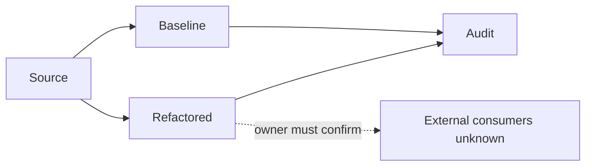

# Dependency and change review

The parser inventories explicit A1 cross-sheet references. Same-sheet references, named ranges, dynamic references and scripts are not a complete lineage graph. `INDIRECT`, `OFFSET`, `IMPORTRANGE` and Excel external syntax are flagged. Absence of a detected incoming edge is never proof that a tab is unused.

| Change | Demo decision | Real-workbook prerequisite |
|---|---|---|
| Replace positional totals with header lookups | Implemented in a separate result tab | Validate unique headers and all report outputs on a copy |
| Consolidate duplicate metric logic | Ratios reuse owning totals | Confirm population, period and units are identical |
| Delete unused tab or column | Not performed | Confirm external exports, scripts, charts, named ranges and owner approval |
| Remove archived records | Not performed | Agree retention rules and reporting history |
| Expand source range | Not performed | Update all formulas, row validation and golden controls together |

## Maintenance

Keep an untouched source copy and date-stamped baseline. Validate source fields, run reconciliation and review every output before replacing formulas. For a real engagement, reconcile every reporting figure, not just this example's eight metrics. Save the dependency inventory and reviewer decision log. Roll back by restoring the untouched copy if any output changes unexpectedly.

## Reviewer decision log template

| Candidate | Evidence | Owner | Decision | Date |
|---|---|---|---|---|
| Real workbook migration | Pending access to actual workbook | Unassigned | Pending | — |
| External consumer check | Cannot be inferred locally | Unassigned | Pending | — |
